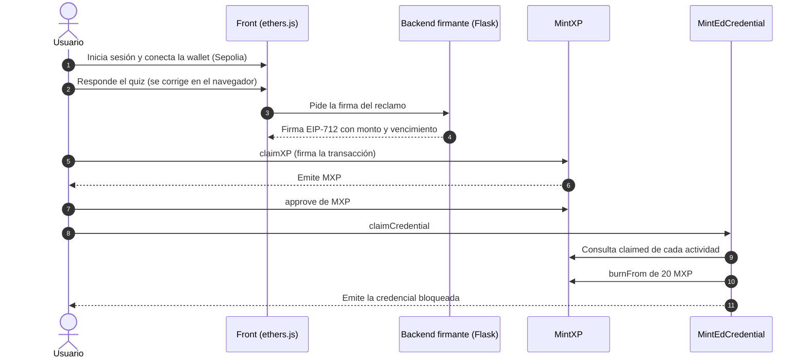

# MintEd

Plataforma educativa Web3 donde se aprende blockchain usando blockchain. El usuario completa actividades, gana **MintXP (MXP)**, un token ERC-20 no transferible (puntos de aprendizaje), y lo quema para obtener una **credencial verificable on-chain** que no se puede transferir y que puede revocarse sin borrarla.

Proyecto final del curso [Ethereum Developer Pack](https://ethkipu.org/ethereumdeveloperpack) de ETH Kipu. Este repositorio contiene el MVP: contratos, backend y front, con los contratos desplegados en la testnet Sepolia.

## Qué hace

```
Aprender → Ganar MXP → Usar MXP → Obtener la credencial
```

1. El usuario se registra o inicia sesión con su correo y conecta su wallet (MetaMask) en Sepolia.
2. Responde un quiz de 5 preguntas y aprueba con 4. Si desaprueba, puede reintentar con otro juego de preguntas. El quiz se corrige en el navegador.
3. Para reclamar MXP, el backend firma un reclamo (EIP-712) y el contrato `MintXP` verifica la firma al ejecutar `claimXP`. Cada par (usuario, actividad) se reclama una sola vez.
4. Con las 3 actividades del recorrido reclamadas, el usuario aprueba el gasto de MXP y llama a `claimCredential`. `MintEdCredential` verifica el progreso on-chain, quema 20 MXP y emite un NFT no transferible.
5. MXP **no es transferible**: solo se gana y se quema.
6. La credencial puede revocarse: el owner la marca como inválida con `revoke`, sin borrarla. Cualquiera consulta el estado con `isValid` y `revocationOf`.

## Por qué blockchain

El contenido educativo (lecciones, quiz, cuentas de usuario) vive off-chain, porque una base de datos es más eficiente para eso. La blockchain se usa donde aporta algo que una base de datos no ofrece:

| Elemento | Dónde vive | Por qué |
|---|---|---|
| Lecciones, quiz y cuentas | Off-chain | Una base de datos resuelve mejor el contenido y los usuarios. |
| Saldo de MXP | On-chain (ERC-20 no transferible) | El saldo queda en la wallet del usuario y no se puede comprar ni vender. |
| Emisión y quema de MXP | On-chain | La oferta total es pública y auditable. |
| Credencial | On-chain (ERC-721 no transferible) | Cualquiera la verifica sin consultar a MintEd. Si se revoca, no se borra: queda un registro público con fecha y motivo. |
| Progreso | On-chain (`claimed`) | El contrato verifica el requisito. No depende de que el backend lo afirme otra vez. |

Además, cada reclamo es una transacción real que el usuario firma y paga con gas: aprende wallets, firmas y contratos usándolos.

## Arquitectura



**Modelo de confianza.** Un contrato no puede ver el contenido off-chain, así que el backend firma el reclamo (EIP-712) y el contrato verifica la firma. Ese firmante es un punto de confianza centralizado. Se acota con un tope por claim (`MAX_CLAIM`, 100 MXP), firmas con vencimiento, un solo claim por (usuario, actividad) y la posibilidad de rotar el firmante con `setClaimSigner`.

### Contratos

| Contrato | Estándar | Qué hace |
|---|---|---|
| [`MintXP`](contracts/contracts/MintXP.sol) | ERC-20 no transferible + `ERC20Burnable`, EIP-712 | Emite MXP solo con una firma válida del `claimSigner`. Registra `claimed[usuario][actividad]` para evitar el doble claim. Solo permite emitir y quemar: cualquier transferencia revierte con `NonTransferable`. |
| [`MintEdCredential`](contracts/contracts/MintEdCredential.sol) | ERC-721 no transferible, compatible con ERC-5192, revocable | Verifica las actividades del recorrido en `MintXP`, quema `burnCost` con `burnFrom` y emite la credencial. `revoke(tokenId, motivo)` (solo owner) la marca como inválida; `isValid` y `revocationOf` la consultan. |

Direcciones en Sepolia (chainId 11155111):

| Contrato | Dirección |
|---|---|
| `MintXP` | [`0xdb90a4C8AC91941935980b7B7c230bE2e6d58426`](https://sepolia.etherscan.io/address/0xdb90a4C8AC91941935980b7B7c230bE2e6d58426) |
| `MintEdCredential` | [`0x25C2633607d40Cc6E832f321aa39aFb6074454E0`](https://sepolia.etherscan.io/address/0x25C2633607d40Cc6E832f321aa39aFb6074454E0) |
| `claimSigner` (firmante del backend) | [`0x3FF19248d1E03b13eb18979767ecdE5aC5856226`](https://sepolia.etherscan.io/address/0x3FF19248d1E03b13eb18979767ecdE5aC5856226) |

## Estructura del repositorio

```
contracts/   Contratos en Solidity, tests y despliegue (Hardhat 3 + Ignition)
Backend/     Registro e inicio de sesión de usuarios y firma de claims (Python, Flask)
Frontend/    Interfaz web (HTML, CSS y JavaScript con ethers.js v6, sin build)
docs/        Whitepaper, guion del pitch y checklist de la prueba end-to-end
```

## Cómo probarlo

Requisitos: Node.js 20 o superior, Python 3, una wallet (por ejemplo MetaMask) con ETH de Sepolia.

### 1. Contratos

```bash
cd contracts
npm install
npx hardhat compile
npx hardhat test              # tests locales, sin red
```

Para desplegar en Sepolia (ya está desplegado; solo si se quiere repetir) se configuran las claves con `npx hardhat keystore set SEPOLIA_RPC_URL`, `SEPOLIA_PRIVATE_KEY` y `ETHERSCAN_API_KEY`, y luego:

```bash
npx hardhat ignition deploy --network sepolia ignition/modules/MintEd.ts --parameters ignition/parameters/sepolia.json --verify
```

En `ignition/parameters/sepolia.json` va la dirección **pública** del firmante (`claimSigner`). Nunca se sube una clave privada.

### 2. Backend y front

```bash
cd Backend
pip install flask eth-account
export SIGNER_PRIVATE_KEY=<clave del firmante, solo en tu máquina>
python server.py
```

El servidor sirve el front desde su propia carpeta: copiar el contenido de `Frontend/` junto a `server.py`. Abrir `http://127.0.0.1:5000`. La dirección del firmante tiene que coincidir con el `claimSigner` de `MintXP`.

Para verificar el ciclo completo paso a paso, seguir [la checklist de prueba end-to-end](docs/CHECKLIST_PRUEBA_E2E.md).

## Parámetros del MVP

| Parámetro | Valor | Dónde se configura |
|---|---|---|
| Actividades del recorrido 1 | 3 (ids 1, 2 y 3) | `createPath` en `ignition/modules/MintEd.ts` |
| MXP que se queman por credencial | 20 | `BURN_COST` en el despliegue (inmutable después) |
| Tope por claim | 100 MXP | `MAX_CLAIM` en `MintXP` |
| Monto firmado por el backend | 100 MXP por reclamo | `Backend/server.py` |
| Vigencia de una firma | 1 hora | `Backend/server.py` |
| Quiz | 5 preguntas, se aprueba con 4 | `Frontend/app.js` |

## Seguridad y límites conocidos

- **Quiz corregido en el navegador:** el backend firma sin comprobar el resultado del quiz, así que hoy el MXP no acredita aprendizaje. En producción el servidor corregiría y firmaría solo si el usuario aprobó.
- **Firmante centralizado:** quien controle su clave puede emitir MXP. La clave no debe estar en el código: se lee de `SIGNER_PRIVATE_KEY` y se rota con `setClaimSigner`. En producción haría falta un servicio de claves gestionado, un multisig como owner y varios firmantes.
- **Revocación:** la hace una sola clave de owner, es irreversible y no reembolsa los MXP quemados. El front todavía no muestra el estado; se consulta en el contrato. En producción haría falta un multisig y criterios públicos.
- **Cuentas de usuario:** el MVP guarda contraseñas sin cifrar en SQLite. Falta hash de contraseñas y Sign-In with Ethereum.
- **Sybil:** una persona puede usar varias wallets. El MVP no tiene prueba de personalidad.
- **Sin auditoría externa.** Está pensado solo para testnet.

El análisis completo está en el whitepaper, sección 5.

## Documentación

- Whitepaper: [`docs/Whitepaper_MintEd_v4.docx`](docs/Whitepaper_MintEd_v4.docx)
- Guion del pitch: [`docs/PITCH_GUION.md`](docs/PITCH_GUION.md)
- Checklist de prueba: [`docs/CHECKLIST_PRUEBA_E2E.md`](docs/CHECKLIST_PRUEBA_E2E.md)

## Stack

Solidity ^0.8.24 · OpenZeppelin Contracts 5 · Hardhat 3 · viem · ethers.js v6 · Python · Flask · SQLite · Sepolia · Etherscan

## Roadmap

Fuera del MVP: corrección del quiz en el servidor, más usos para MXP, Proof of Personhood, varios recorridos y credenciales por nivel, metadata de la credencial en IPFS, migración a un L2 y multisig para el firmante.

## Equipo

- David P
- Graciano Chalian
- Melina Alarcon
- Rocio Pedrozo

## Licencia

MIT
