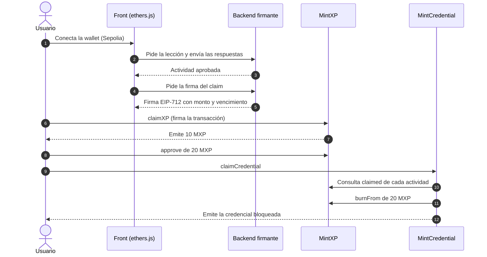

# MintEd

Plataforma educativa Web3 donde se aprende blockchain usando blockchain. El usuario completa actividades, gana **MintXP (MXP)**, un token ERC-20, y lo quema para obtener una **credencial verificable on-chain** que no se puede transferir.

Proyecto final del curso [Ethereum Developer Pack](https://ethkipu.org/ethereumdeveloperpack) de ETH Kipu. Este repositorio contiene el MVP: contratos, backend y front, desplegados en la testnet Sepolia.

> **Completar antes de entregar:** nombres del equipo, direcciones de los contratos y link al whitepaper (ver las secciones marcadas con _completar_).

## Qué hace

```
Aprender → Ganar MXP → Usar MXP → Obtener la credencial
```

1. El usuario conecta su wallet en Sepolia.
2. Lee una lección y responde un quiz de 4 preguntas (aprueba con 3). El backend lo corrige. Tiene 3 intentos con preguntas distintas en cada uno; si falla los tres, la actividad se bloquea 24 horas para repasar.
3. Si aprueba, reclama 10 MXP: el backend firma el reclamo y el contrato `MintXP` verifica la firma.
4. Con las 3 actividades completas (30 MXP), reclama la credencial. `MintCredential` verifica el progreso on-chain, quema 20 MXP y emite un NFT no transferible.
5. El MXP restante se puede acumular o transferir a otra dirección.

## Por qué blockchain

El contenido educativo (lecciones, quizzes, corrección) vive off-chain, porque una base de datos es más eficiente para eso. La blockchain se usa donde aporta algo que una base de datos no ofrece:

| Elemento | Dónde vive | Por qué |
|---|---|---|
| Lecciones y quizzes | Off-chain | Una base de datos resuelve mejor el contenido y la corrección. |
| Propiedad y transferencia de MXP | On-chain (ERC-20) | El usuario custodia sus tokens, sin cuenta en la plataforma. |
| Emisión y quema de MXP | On-chain | La oferta total es pública y auditable. |
| Credencial | On-chain (ERC-721 no transferible) | Cualquiera la verifica sin consultar a MintEd, y la plataforma no puede alterarla. |
| Progreso | On-chain (`claimed`) | El contrato verifica el requisito. No depende de que el backend lo afirme otra vez. |

Además, cada reclamo es una transacción real que el usuario firma y paga con gas: aprende wallets, firmas y contratos usándolos.

## Arquitectura



**Modelo de confianza.** Un contrato no puede ver el contenido off-chain, así que el backend corrige el quiz y firma el reclamo (EIP-712). Ese firmante es un punto de confianza centralizado. Se acota con un tope por claim, firmas con vencimiento, un solo claim por (usuario, actividad) y la posibilidad de rotar el firmante.

### Contratos

| Contrato | Estándar | Qué hace |
|---|---|---|
| [`MintXP`](contracts/contracts/MintXP.sol) | ERC-20 + `ERC20Burnable`, EIP-712 | Emite MXP solo con una firma válida del `claimSigner`. Registra `claimed[usuario][actividad]` para evitar el doble claim. |
| [`MintEdCredential`](contracts/contracts/MintEdCredential.sol) | ERC-721 no transferible, compatible con ERC-5192 | Verifica las actividades del path en `MintXP`, quema `burnCost` con `burnFrom` y emite la credencial. |

Direcciones en Sepolia: _completar_

| Contrato | Dirección |
|---|---|
| `MintXP` | 0xdb90a4C8AC91941935980b7B7c230bE2e6d58426 |
| `MintEdCredential` | 0x25C2633607d40Cc6E832f321aa39aFb6074454E0 |

## Estructura del repositorio

```
contracts/   Contratos en Solidity, tests y script de deploy (Hardhat)
backend/     Contenido de las actividades, corrección de quizzes y firma de claims (Node.js)
front/       Interfaz web (HTML y JavaScript con ethers.js v6, sin build)
docs/        Whitepaper, guion del pitch y checklist de la prueba end-to-end
```

Cada carpeta tiene su propio README con el detalle.

## Cómo probarlo

Requisitos: Node.js 20.6 o superior, una wallet (por ejemplo MetaMask) con ETH de Sepolia, un RPC de Sepolia y una API key de Etherscan.

### 1. Contratos

```bash
cd contracts
npm install
npm test                      # tests locales, sin red
cp .env.example .env          # completar RPC, clave del deployer, API key y CLAIM_SIGNER_ADDRESS
npm run deploy:sepolia
```

`CLAIM_SIGNER_ADDRESS` es la dirección (nunca la clave) de una wallet nueva que usará el backend para firmar. El script despliega ambos contratos, crea el path 1 con las actividades 1, 2 y 3, verifica el código en Etherscan e imprime las direcciones.

### 2. Backend

```bash
cd backend
npm install
npm test
cp .env.example .env          # SIGNER_PRIVATE_KEY y MINTXP_ADDRESS (la desplegada)
npm start
```

Al arrancar imprime la dirección del firmante: tiene que coincidir con el `claimSigner` de `MintXP`.

### 3. Front

Pegar las direcciones de los contratos en `front/config.js` y servir la carpeta por HTTP:

```bash
cd front
python3 -m http.server 8000
```

Abrir `http://localhost:8000`. El origen tiene que coincidir con `ALLOWED_ORIGIN` del backend, por defecto `http://localhost:8000`.

Para verificar el ciclo completo paso a paso, seguir [la checklist de prueba end-to-end](docs/CHECKLIST_PRUEBA_E2E.md).

## Parámetros del MVP

| Parámetro | Valor | Dónde se configura |
|---|---|---|
| MXP por actividad | 10 | `AMOUNT_PER_ACTIVITY` en el backend |
| Actividades del path 1 | 3 (ids 1, 2 y 3) | `createPath` en el deploy, `activities.js` y `front/config.js` |
| MXP que se queman por credencial | 20 | `BURN_COST` en el deploy (inmutable después) |
| Tope por claim | 100 MXP | `MAX_CLAIM` en `MintXP` |
| Vigencia de una firma | 10 minutos | `DEADLINE_SECONDS` en el backend |
| Quiz | 4 preguntas por intento, se aprueba con 3 | `passScore` en `activities.js` |
| Intentos de quiz | 3 por actividad, con preguntas distintas en cada uno; sin puntaje al fallar | `MAX_ATTEMPTS` en el backend |
| Bloqueo tras el tercer fallo | 24 horas, por actividad | `LOCKOUT_HOURS` en el backend |

## Seguridad y límites conocidos

- **Firmante centralizado:** quien controle su clave puede emitir MXP. En producción haría falta un servicio de claves gestionado, un multisig como owner y varios firmantes.
- **Sybil:** una persona puede usar varias wallets. El MVP no tiene prueba de personalidad.
- **Bots:** el quiz es un banco finito (3 juegos de 4 preguntas por actividad) y se puede automatizar con wallets nuevas. Los 3 intentos con preguntas distintas, sin puntaje y con bloqueo de 24 h encarecen el ensayo y error por wallet, pero no lo impiden.
- **Backend sin autenticación de usuario:** no comprueba que quien consulta controle la dirección. El progreso del quiz vive en memoria.
- **Sin auditoría externa.** Está pensado solo para testnet.

El análisis completo está en el whitepaper, sección 5.

## Documentación

- Whitepaper: [`docs/Whitepaper_MintEd_v3.docx`](docs/Whitepaper_MintEd_v3.docx)
- Guion del pitch: [`docs/PITCH_GUION.md`](docs/PITCH_GUION.md)
- Checklist de prueba: [`docs/CHECKLIST_PRUEBA_E2E.md`](docs/CHECKLIST_PRUEBA_E2E.md)

## Stack

Solidity 0.8.28 · OpenZeppelin Contracts 5 · Hardhat · ethers.js v6 · Node.js 20 · Sepolia · Etherscan

## Roadmap

Fuera del MVP: más usos para MXP, intercambio por otros activos, Proof of Personhood, varios learning paths y credenciales por nivel, metadata de la credencial en IPFS, migración a un L2 y multisig para el firmante.

## Equipo

_completar nombres y roles_

## Licencia

MIT
